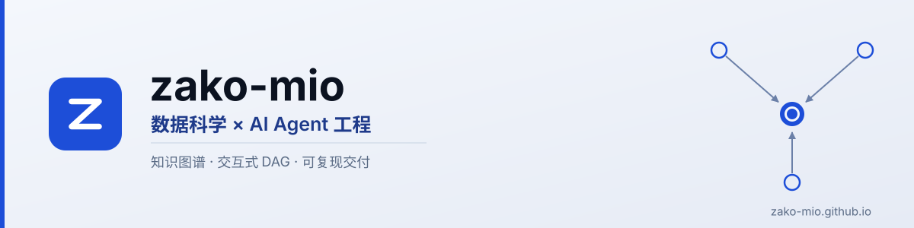
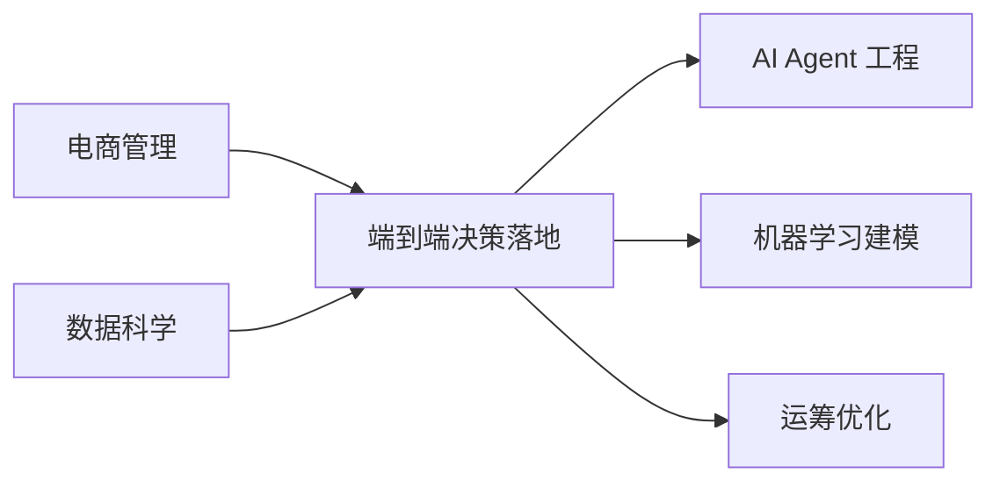

<!--
  图形资产由 scripts/make_banner.py 派生（明/暗两版同一真相源），⛔ 请勿手改 assets/*.svg。
  本文件中的数字一律不手抄：规模与口径以 https://zako-mio.github.io/stats/ 为唯一落点。
-->

<picture>
  <source media="(prefers-color-scheme: dark)" srcset="assets/banner-dark.svg">
  <source media="(prefers-color-scheme: light)" srcset="assets/banner-light.svg">
  
</picture>

**电商管理 × 数据科学**复合背景，聚焦 **AI Agent 工程 / 机器学习建模 / 运筹优化**；长于在不确定环境中做**端到端决策落地**。

> 作品全部公开在线 → **[zako-mio.github.io](https://zako-mio.github.io/)** （Tech Hub：全量索引 · 聚合指标 · 关于 · 在用）

  <a href="https://zako-mio.github.io/works/"><b>作品</b></a> ·
  <a href="https://zako-mio.github.io/stats/"><b>聚合</b></a> ·
  <a href="https://zako-mio.github.io/about/"><b>关于</b></a> ·
  <a href="https://zako-mio.github.io/uses/"><b>在用</b></a> ·
  <a href="https://github.com/zako-mio?tab=repositories"><b>GitHub</b></a>

---

## 定位

> 两个背景汇聚到一个核心动作，再展开为三个聚焦方向。

若此处未渲染成图：电商管理 × 数据科学 → **端到端决策落地** → AI Agent 工程 · 机器学习建模 · 运筹优化。

---

## 主线作品

三条最完整的作品线，每条都有在线预览。

| 作品 | 一句话 | 入口 |
| --- | --- | --- |
| **DeepSeek Harness 插件级 DAG 依赖链分析** | 插件依赖链全量摊平，含模块内部动态 DAG | [预览](https://zako-mio.github.io/deepseek-harness-plugin-dag/) · [仓库](https://github.com/zako-mio/deepseek-harness-plugin-dag) |
| **12 Factor 方法论合并知识图谱** | 12 Factor App × Agent 合并方法论图 + 双交付 | [预览](https://zako-mio.github.io/12-factor-methodology-kg/) · [仓库](https://github.com/zako-mio/12-factor-methodology-kg) |
| **算法知识图谱** | 算法体系按 what-why-how 组织，三级下钻 DAG | [预览](https://zako-mio.github.io/algorithm-knowledge-graph/) · [仓库](https://github.com/zako-mio/algorithm-knowledge-graph) |

<b>全部作品（10 项 · 点击展开）</b>

> 完整的筛选索引（按类型 / 领域 / 语言）与规模口径在 **[作品页](https://zako-mio.github.io/works/)** 与 **[聚合页](https://zako-mio.github.io/stats/)**；下表只作导航。

| 作品 | 领域 | 入口 |
| --- | --- | --- |
| 控制理论 ⊗ Agent 设计知识库 | Agent 工程 · 控制理论 | [预览](https://zako-mio.github.io/control-theory-agent-kb/) · [仓库](https://github.com/zako-mio/control-theory-agent-kb) |
| LLM 关键节点论文全集（2017–2026） | 大模型 | [预览](https://zako-mio.github.io/llm-papers-knowledge-base/) · [仓库](https://github.com/zako-mio/llm-papers-knowledge-base) |
| 软件工程 / 架构设计方法论知识图谱 | 软件工程 · Agent 工程 | [预览](https://zako-mio.github.io/se-architecture-methodology-kg/) · [仓库](https://github.com/zako-mio/se-architecture-methodology-kg) |
| Open Code Review 项目解析知识图谱 | 软件工程 | [预览](https://zako-mio.github.io/open-code-review-kg/) · [仓库](https://github.com/zako-mio/open-code-review-kg) |
| opencode DAG 依赖链分析 | Agent 工程 | [预览](https://zako-mio.github.io/opencode-dag-analysis/) · [仓库](https://github.com/zako-mio/opencode-dag-analysis) |
| dsh-manager 插件深度分析 | Agent 工程 | [预览](https://zako-mio.github.io/dsh-manager-analysis/) · [仓库](https://github.com/zako-mio/dsh-manager-analysis) |
| GitHub 新手全功能 DAG 教程 | GitHub · 教程 | [预览](https://zako-mio.github.io/github-dag-tutorial/) · [仓库](https://github.com/zako-mio/github-dag-tutorial) |
| 技术知识中枢主页（本站自身即作品） | — | [预览](https://zako-mio.github.io/) · [仓库](https://github.com/zako-mio/zako-mio.github.io) |

---

## 工作方式

先定口径，再采数，然后验证产物，最后复盘；复盘的结果回流成下一轮的口径修正。

| 步骤 | 做法 |
| --- | --- |
| **01 定口径** | 术语不一致时先写规范，宁可空着也不拼凑可比性 |
| **02 再采数** | 单一真相源 + 派生：能派生的数字不手抄，改了源就重生成 |
| **03 验产物** | 门控读真实产物而非源码自述，每道都带负向夹具证明判据可判假 |
| **04 做复盘** | 结论要能回源，取证与门控随产物一起留档 |

---

## 工具链

- **语言** · <code>Python</code> <code>TypeScript</code> <code>SQL</code>
- **构建与前端** · <code>Next.js</code> <code>React</code> <code>Node</code> <code>静态导出</code>
- **可视化与图谱** · <code>ECharts</code> <code>Cytoscape.js</code> <code>D3</code> <code>SVG</code>
- **工程与交付** · <code>Git</code> <code>GitHub Actions</code> <code>门控与负向夹具</code> <code>可复现留档</code>

---

## 联系

- **Tech Hub** · <https://zako-mio.github.io/>
- **GitHub** · <https://github.com/zako-mio>
- **邮箱** · <1505788754@qq.com>

以匿名方式呈现：不出现姓名、单位、地域等可实名定位的字段 —— 作品集的分量来自作品本身，而不是履历。 
本页不放规模数字：取值、口径与边界情况集中在<a href="https://zako-mio.github.io/stats/">聚合页</a>，避免同一组数字出现第二处真相源。

